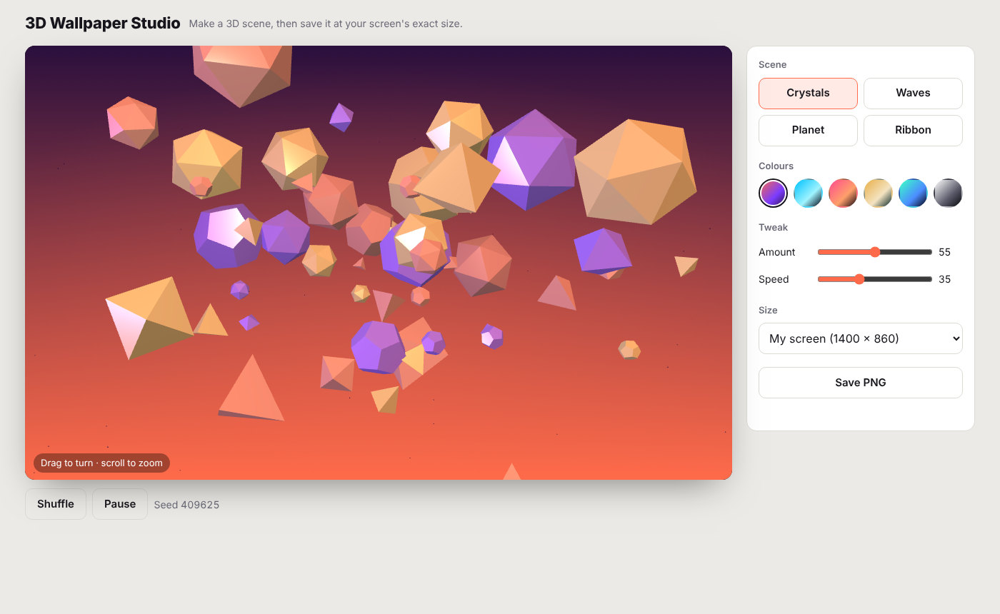
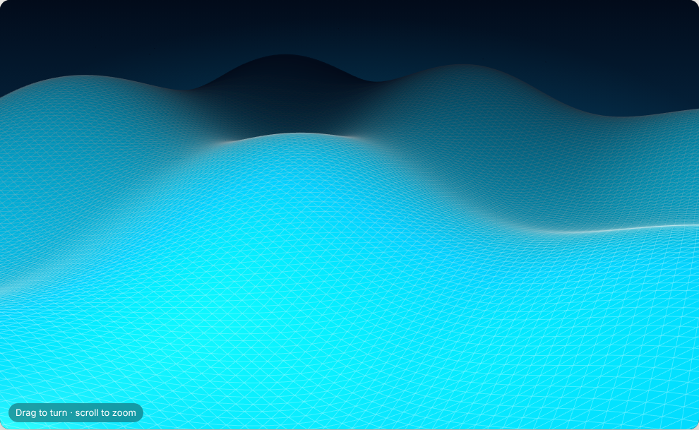
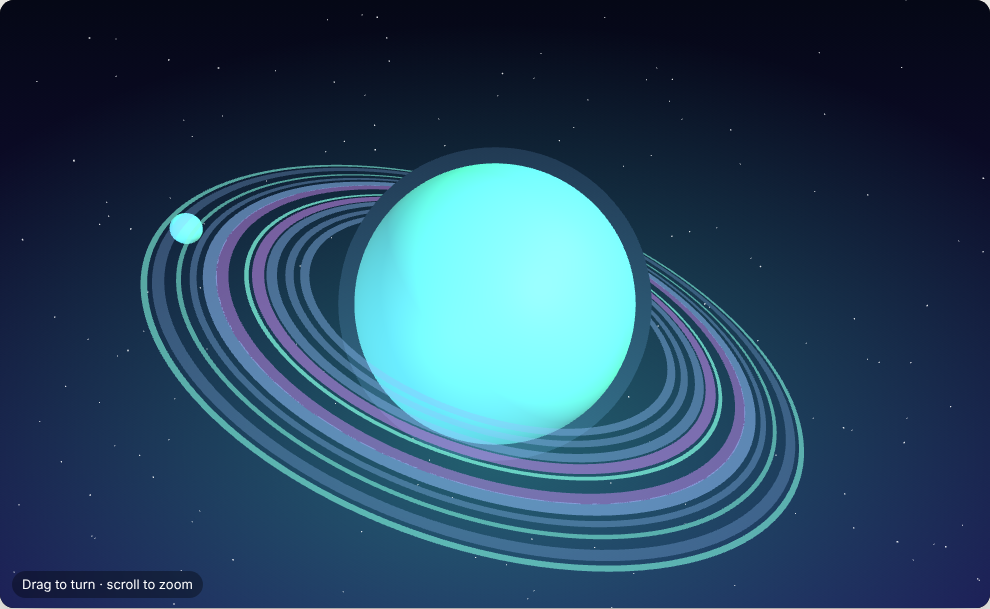
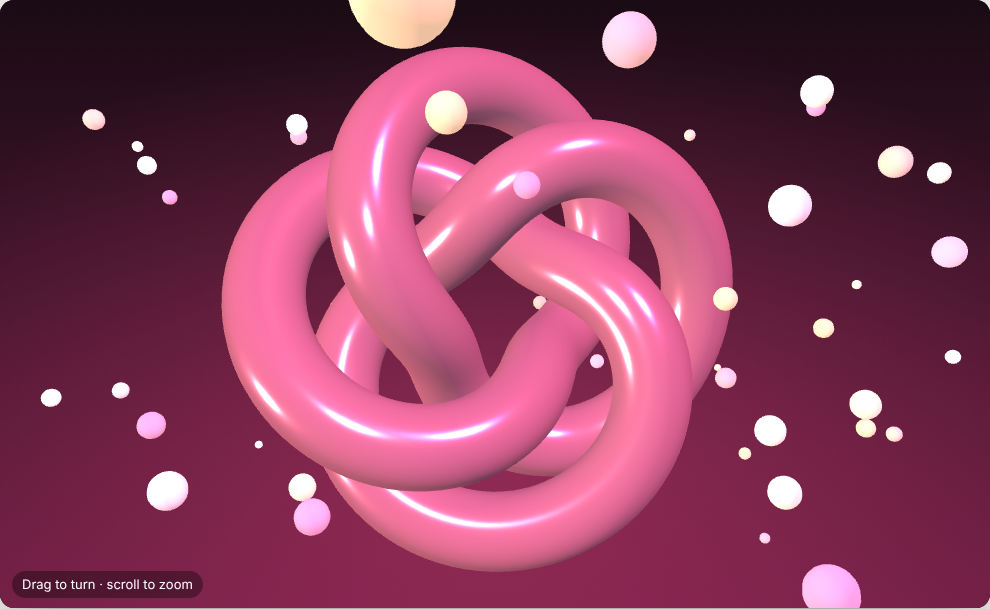

# 3D Wallpaper Studio

Make animated 3D desktop wallpapers in your browser, then save them as a PNG at your screen's exact size (up to 4K and ultrawide).

**[▶ Try the live demo](https://zakariaagourri.github.io/3d-wallpaper-studio/)**

| Waves | Planet | Ribbon |
|---|---|---|
|  |  |  |

## Features

- **4 real-time 3D scenes:** Crystals, Waves, Planet and Ribbon, built with [Three.js](https://threejs.org/) (WebGL).
- **6 colour themes**, plus sliders for amount and speed.
- **Seeded randomness:** every design has a seed number, so the same seed always rebuilds the same scene. Shuffle (or the Space bar) makes a new one.
- **Camera controls:** drag to orbit, scroll to zoom.
- **Exact-size export:** the preview matches your screen's shape, and the export re-renders the scene off-screen at full resolution (1080p, 1440p, 4K, ultrawide, MacBook or your own screen).
- **One-click wallpaper (desktop app version):** when installed as a Claude desktop app, it saves to `Pictures/3D Wallpapers` and sets the background itself: PowerShell + `SystemParametersInfo` on Windows, AppleScript on macOS, `gsettings` on GNOME Linux.

## Run it

It's a single HTML file with no build step.

1. Download or clone this repo.
2. Open `index.html` in Chrome, Edge or Firefox.
3. Pick a scene, press **Save PNG**, then set the image as your background.

## How it works

- **Rendering:** a `WebGLRenderer` with `preserveDrawingBuffer` so the canvas can be exported. For a save, the renderer is resized to the target resolution, renders one frame, exports with `canvas.toBlob()`, then goes back to the preview size.
- **Scenes:** each scene is a builder function that adds meshes to a group and returns an animation step. Old geometries and materials are disposed on every rebuild to avoid GPU memory leaks.
- **Waves:** a 50×50 plane with up to 200×200 segments. Vertex heights are recalculated every frame from layered sine waves, then normals are recomputed for flat shading.
- **Randomness:** a small seeded random number generator (mulberry32) so designs can be reproduced.
- **Settings** are remembered in `localStorage`.

## Built with

- HTML, CSS and JavaScript (no framework)
- Three.js r128
- Built with Claude (Anthropic) as an AI pair programmer. I directed the features, tested it and published it.

## Licence

MIT
